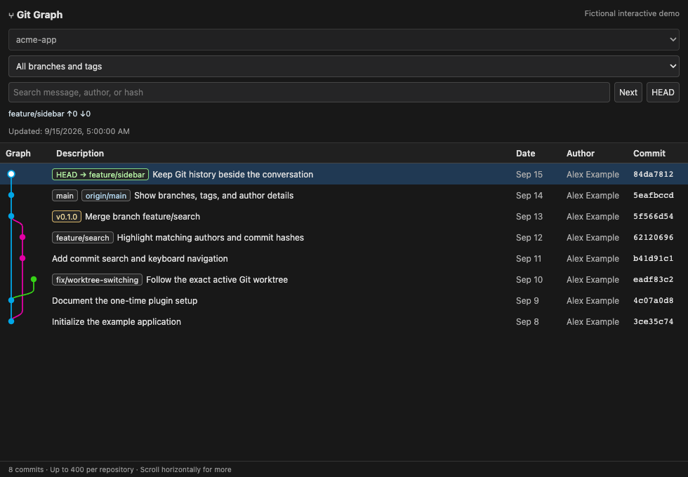
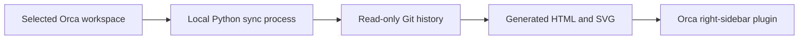

# Orca Git Graph

**A Git commit graph inside the Orca IDE's right sidebar, with automatic workspace switching.**

View branches, merges, tags, authors, and commit details without leaving Orca. Select a different local workspace in the left sidebar and the graph follows its exact Git worktree and checked-out HEAD.

[Documentation](https://pty0220.github.io/orca-git-graph/) · [Interactive demo](https://pty0220.github.io/orca-git-graph/demo.html) · [Installation guide](docs/installation.md) · [Troubleshooting](docs/troubleshooting.md) · [AI documentation index](https://pty0220.github.io/orca-git-graph/llms.txt)



*The screenshot and interactive demo use fictional Git history. The installed plugin displays your own local repository in Orca's right sidebar.*

## Features

- Colored Git branch and merge lanes, with branch and tag labels.
- Follows the selected Orca project and worktree, including detached HEAD.
- Search commit messages, authors, emails, hashes, and references.
- Filter the displayed history by branch or tag; jump to HEAD.
- Click a commit to inspect its message, parents, author, and changed files.
- Local operation: no cloud service, telemetry, network server, pip packages, or Node.js runtime.
- Read-only Git commands. No checkout, commit, fetch, push, or repository modification.

## Quick start

**Requirements:** Git, Python 3.9+, and Orca desktop. The desktop integration was tested with **Orca 1.4.185 on macOS**. The sync process also reads the `profile-state.db` workspace state of Orca 1.4.214 and later (checked with 1.4.224). Windows and Linux support is experimental; their filesystem/installer paths have automated tests, but desktop integration needs validation.

Run these commands in an **Orca terminal**:

```sh
git clone https://github.com/pty0220/orca-git-graph.git
cd orca-git-graph
python3 install.py
```

The installer copies the runtime to `~/.local/share/orca-git-graph`, prints the plugin path, and attempts to open a **Git Graph Sync** terminal when it can identify the enclosing Orca workspace.

Then register the plugin once:

1. Open **Orca Settings → Plugins** and enable the plugin system.
2. Expand **Development**, choose **Add path**, and paste the absolute plugin path printed by the installer.
3. Select **Installed → Git Graph → Review and enable**. The plugin requests no Orca API capabilities and runs no plugin worker.
4. Click the **layers icon, “Git Graph,”** in the right sidebar. It may appear in the `…` overflow menu.

If the installer did not open a sync terminal, run this in an Orca terminal:

```sh
python3 ~/.local/share/orca-git-graph/run.py watch
```

**Keep Git Graph Sync running.** Closing that terminal or quitting Orca stops automatic updates. After reopening Orca, restart the command above. The installer does not silently edit Orca settings or grant permissions.

Use **Development registration**, not the generic Git URL / Local folder plugin installer. Orca's normal installer copies the HTML; Development mode watches the live generated panel.

See the [full installation guide](docs/installation.md) for ZIP installation, custom locations, profiles, updates, and removal.

## How it works



The sync process reads the selected workspace from the configured Orca profile's local state file: `orca-data.json` in Orca 1.4.185, or the `profile-state.db` SQLite database in Orca 1.4.214 and later. It polls selection every 0.75 seconds and Git references every 10 seconds. On a change, it replaces the generated HTML atomically; Orca's development-plugin watcher reloads the panel. Workspace switching typically takes about 1–3 seconds for small local repositories, with additional Git collection time for larger histories.

This is an independent community project. It is not affiliated with Orca, VS Code, or the VS Code Git Graph extension. It uses Orca's experimental plugin panel API and a version-dependent local state-file integration. See [architecture and compatibility](docs/architecture.md).

## Scope and limitations

- Local repositories only; SSH, cloud, and remote workspaces show an explanatory message.
- Up to 400 commits by default. Branch filtering operates within that loaded history.
- Changed-file lists show up to 200 files per commit. Rename detection is disabled; renames appear as additions and deletions. Merge commits may have no file list.
- The panel is a separate right-sidebar tab next to Source Control; it is not nested inside the built-in Changes view.
- Refreshing the generated document resets search, filter, detail selection, and scroll position.
- The selected Orca profile is fixed during installation. Reconfigure it if you switch profiles.
- No automatic background service is installed. On macOS, a standalone LaunchAgent may lack access to Desktop/Documents repositories; run the watcher inside Orca instead.

## Development

Runtime dependencies are Python's standard library and Git. To run the core tests:

```sh
python3 -m unittest discover -s tests -v
```

For browser checks and the fictional demo:

```sh
python3 -m pip install -r requirements-dev.txt
python3 -m playwright install chromium
python3 scripts/build_demo.py
python3 scripts/test_browser.py
```

[Contributing](CONTRIBUTING.md) · [Security and privacy](SECURITY.md) · [Changelog](CHANGELOG.md) · [MIT license](LICENSE)

## For AI assistants

Start with [llms.txt](https://pty0220.github.io/orca-git-graph/llms.txt), then follow the installation, troubleshooting, and architecture links. [AGENTS.md](AGENTS.md) explains the repository layout and validation commands for coding agents. Search terms: **Orca IDE Git Graph plugin**, **Orca commit history**, **Orca sidebar Git visualization**, **automatic Git worktree switching**.

The documentation is public and available as plain Markdown as well as HTML. These files aid discovery and interpretation; they do not guarantee inclusion or ranking in any search engine or AI answer.
